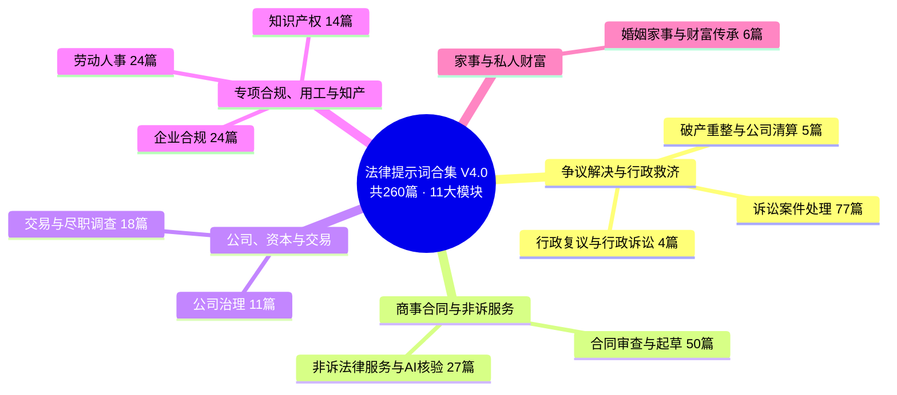
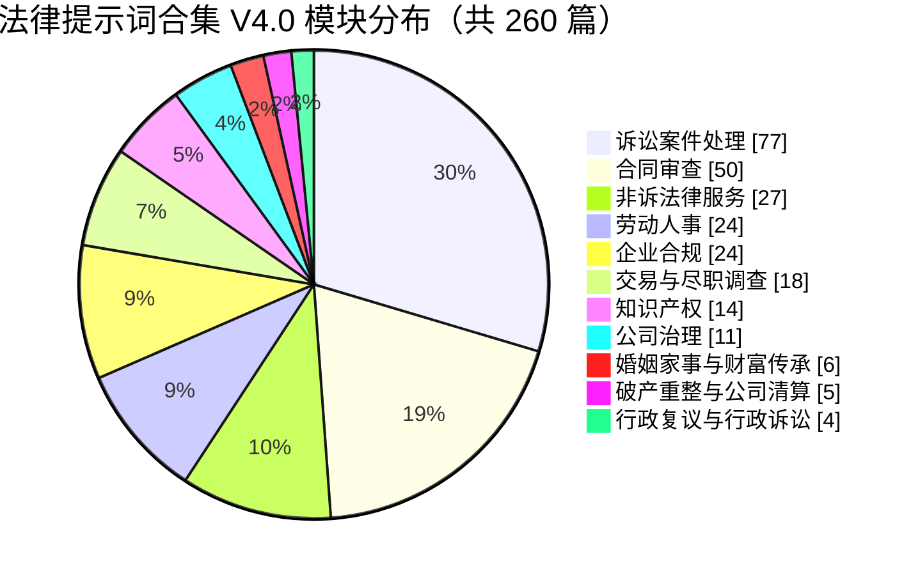
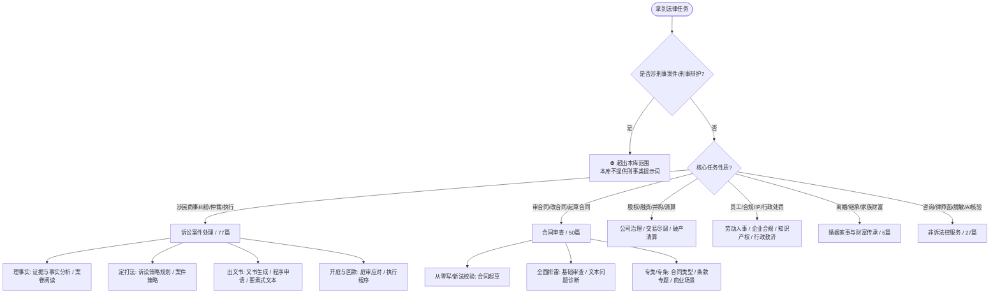
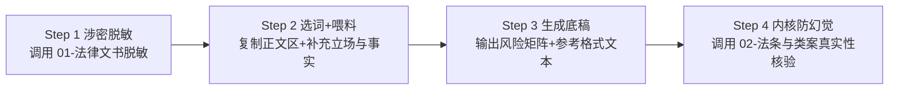

# ⚖️ 法律工作提示词合集（V4.0）

> 面向执业律师、企业法务、合规官、法官助理与法律研究员的**中文 AI 实务提示词工程库**。全库共收录 **260 篇**标准化提示词，横跨 **11 个一级非刑事法律业务模块**，每一篇均内置**标准化处理 SOP**、**可直接套用的参考格式文本**与**大模型防幻觉护栏**，助力法律人高效产出专业级工作底稿。

**版本**：`V4.0 (2026-11-21)` ｜ **规模**：`260 篇 / 11 大业务模块` ｜ **许可协议**：`CC BY-NC-SA 4.0（个人免费需署名 / 商用须授权）` ｜ **适用范围**：`民商事、公司、劳动、合规、知产、家事、破产与行政救济（不含刑事）`

## 📌 目录导航

- [一、V4.0 升级总则与核心设计理念](#一v40-升级总则与核心设计理念)
- [二、全库架构全景与模块分布图](#二全库架构全景与模块分布图)
- [三、30 秒精准选词决策树](#三30-秒精准选词决策树)
- [四、完整业务模块与目录索引](#四完整业务模块与目录索引)
- [五、实战使用指南与完整调用示例](#五实战使用指南与完整调用示例)
- [六、使用边界、排除范围与执业免责声明](#六使用边界排除范围与执业免责声明)
- [七、使用协议与商业授权](#七使用协议与商业授权)

## 一、V4.0 升级总则与核心设计理念

相比 V3.0，**V4.0（2026-11-21 更新）**围绕“**更专业、更落地、防幻觉、易复制**”四大目标完成了全库系统性升级：

1. **统一“六段式 SOP + 参考格式文本”黄金骨架**：全库 260 篇提示词 100% 遵循统一标准结构，既规定了 AI 思考的**分步法律处理 SOP（Step 1 → Step N）**，又内置了**可直接修改提交/签署的参考格式文本**（起诉状、答辩状、决议、协议条款、整改任务单等），避免 AI 输出空泛说教。
2. **全库注入大模型防幻觉与执业边界护栏**：100% 强制内置三大硬约束——严禁编造法条序号与判例案号（存疑标注 `[待核实]`）、严格忠于输入事实不脑补、明确工作底稿执业边界。
3. **场景化立场确认机制**：全面清除跨模块套壳话术，按业务领域精准定制立场追问（如原被告、投融资双方、用人单位/劳动者、广告主/MCN/平台、控股/中小股东等）。
4. **紧跟中国最新现行立法与司法实践**：系统融入**2023修订《公司法》（2024年7月施行）**、**《民法典合同编通则司法解释》**、**《劳动争议司法解释（二）》**、**新《行政复议法》**、**最高法要素式起诉状/答辩状示范文本**以及**AIGC/数据出境最新监管规则**。
5. **一键复制友好设计**：每篇提示词末尾通过 `> 💡 使用提示` 明确隔离“可整体复制发给 AI 的正文区”与“知识库关联索引区”，并完成全库双链零断链校验。

## 二、全库架构全景与模块分布图

### 1. 业务版图全景（11 大一级模块 · 260 篇）



### 2. 各模块体量分布统计



| 序号 | 一级业务模块 | 篇数 | 占比 | 核心子目录结构 | V4.0 重点亮点 |
|:---:|-------------|-----:|-----:|---------------|--------------|
| 1 | **诉讼案件处理** | 77 | 29.6% | 证据与事实分析、案卷阅读与分析、诉讼策略规划、案件策略、文书生成、庭审应对、程序申请、执行程序、裁判文书分析 | 新增要素式起诉/答辩状、二审/再审答辩状、庭审笔录复盘、执行分配异议、纯民事失信限高拘留策略 |
| 2 | **合同审查** | 50 | 19.2% | 基础审查、文本问题诊断、修改与谈判、条款专题、合同类型、商业与交易场景、**合同起草（新增）** | 补齐从零起草商业合同、合同编通则司法解释校验、AI算力与数据交易合同、跨境商事合同（CISG） |
| 3 | **非诉法律服务** | 27 | 10.4% | 咨询答复、文书生成、**AI协作与核验（新增）** | 深度重构法律意见书；新增文书脱敏预处理、法条/类案防幻觉终审、多文档交叉比对 |
| 4 | **劳动人事** | 24 | 9.2% | 专项处理、制度审查 | 深度重构员工手册/竞业限制/劳动仲裁/不胜任/违纪调查；新增新业态灵活用工与社保合规评估 |
| 5 | **企业合规** | 24 | 9.2% | 基础合规与调查、数据与营销合规、反垄断与跨境贸易、财税与证券合规、环保与安全生产 | 原单一目录拆分为 5 大专业板块；深度重构数据/隐私/广告/平台合规；新增 AIGC 备案与数据出境 |
| 6 | **交易与尽职调查** | 18 | 6.9% | 尽职调查（8篇）、交易文件（10篇） | 消除根目录散放文件，100% 补齐中国现行法条锚点；深度重构股权转让协议（新公司法88条）与 Term Sheet |
| 7 | **知识产权** | 14 | 5.4% | 商标、专利、著作权、综合 | 新增专利 FTO 尽调、专利无效宣告与答辩、开源软件许可证合规（GPL/MIT）、AIGC 版权评估 |
| 8 | **公司治理** | 11 | 4.2% | 内部治理、专项审查 | 深度重构对外担保、关联交易与三会决议；新增新《公司法》五年实缴/股东失权与定向减资方案 |
| 9 | **婚姻家事与财富传承** | 6 | 2.3% | 婚姻协议与纠纷、继承与财富规划 | **全新模块**：离婚协议、股权分割、抚养权策略、遗嘱审查、法定继承纠纷、家企资产隔离规划 |
| 10 | **破产重整与公司清算** | 5 | 1.9% | 清算与破产程序、债权与资产处置 | **全新模块**：自行/强制清算（新公司法董事清算义务人）、破产申请/异议、债权申报、撤销权、重整计划审查 |
| 11 | **行政复议与行政诉讼** | 4 | 1.5% | 行政救济实务 | **全新模块**：行政处罚听证/申辩、新《行政复议法》复议申请、行政起诉状、市监/税务处罚救济与信用修复 |

## 三、30 秒精准选词决策树



## 四、完整业务模块与目录索引

```text
法律提示词合集V4.0/
├── 诉讼案件处理/（77）
│   ├── 证据与事实分析/（4）     ├── 案卷阅读与分析/（4）     ├── 诉讼策略规划/（8）
│   ├── 案件策略/（9）           ├── 文书生成/（15）          ├── 庭审应对/（6）
│   ├── 程序申请/（17）          ├── 执行程序/（10）          └── 裁判文书分析/（4）
├── 合同审查/（50）
│   ├── 合同起草/（4，新增）     ├── 基础审查/（8）           ├── 文本问题诊断/（4）
│   ├── 修改与谈判/（2）         ├── 条款专题/（7）           ├── 合同类型/（8）
│   └── 商业与交易场景/（17）
├── 非诉法律服务/（27）
│   ├── 咨询答复/（7）           ├── 文书生成/（17）          └── AI协作与核验/（3，新增）
├── 劳动人事/（24）
│   ├── 专项处理/（21）          └── 制度审查/（3）
├── 企业合规/（24）
│   ├── 基础合规与调查/（5）     ├── 数据与营销合规/（6）     ├── 反垄断与跨境贸易/（6）
│   ├── 财税与证券合规/（5）     └── 环保与安全生产/（2）
├── 交易与尽职调查/（18）
│   ├── 尽职调查/（8）           └── 交易文件/（10）
├── 知识产权/（14）
│   ├── 专利/（5）               ├── 著作权/（4）             ├── 商标/（2）
│   └── 综合/（3）
├── 公司治理/（11）
│   ├── 内部治理/（9）           └── 专项审查/（2）
├── 婚姻家事与财富传承/（6，新增）
│   ├── 婚姻协议与纠纷/（3）     └── 继承与财富规划/（3）
├── 破产重整与公司清算/（5，新增）
│   ├── 清算与破产程序/（2）     └── 债权与资产处置/（3）
└── 行政复议与行政诉讼/（4，新增）
    └── 行政救济实务/（4）
```

## 五、实战使用指南与完整调用示例

### 标准四步工作流（推荐配合所有大模型使用）



### 示例 1：合同审查场景（股权转让协议防新《公司法》坑）

- **选用提示词**：`交易与尽职调查/交易文件/01-股权转让协议专项审查.md`
- **复制范围**：从标题 `# 股权转让协议（SPA）专项审查提示词` 复制至 `> 💡 使用提示` 上方结束。
- **用户追加输入示例**：
  ```text
  【我的立场】买方（受让方），拟以300万元收购目标公司30%股权。
  【核心事实】目标公司注册资本1000万元，原股东仅实缴100万元，其余未实缴（认缴期至2030年）；对方发来的草稿要求签约3日内一次性付全款，且未写明其他股东放弃优先购买权。
  【待审合同文本】（此处粘贴脱敏后的协议原文）
  ```
- **预期高质量产出**：AI 将自动按新《公司法》第84条、第88条识别“未实缴出资由受让人承接”的隐蔽大坑，输出《风险审查表》、可直接替换粘贴的**分期共管付款条款 + 未实缴出资切割条款**，以及交割清单（Closing Checklist）。

### 示例 2：诉讼文书与庭审协同（从一审判决到二审上诉）

- **组合拳调用顺序**：
  1. 先调用 `诉讼案件处理/裁判文书分析/02-突破点挖掘.md` 拆解一审判决书漏洞；
  2. 再调用 `诉讼案件处理/文书生成/05-上诉状起草.md` 生成结构化《民事上诉状》初稿；
  3. 最后调用 `非诉法律服务/AI协作与核验/02-法条与类案真实性交叉核验.md` 排查所有法条条号与引用案号，确保提交法庭前零幻觉。

### 示例 3：企业日常营销合规（3 分钟审核短视频带货脚本）

- **选用提示词**：`企业合规/数据与营销合规/03-广告宣传合规审查.md`
- **用户追加输入示例**：
  ```text
  【身份】品牌方（广告主），普通功能性护肤品（非特妆），拟在抖音短视频发布。
  【脚本原文】“全网第一抗老精华！中科院专家强力推荐，7天彻底抚平法令纹，无效退款，原价999元今天限时199元！”
  ```
- **预期高质量产出**：AI 将逐句识别“绝对化用语 / 虚假科研机构背书 / 普通化妆品宣称医疗抗衰功效 / 虚构原价”四大红线，并直接给出一版**保留营销转化力但完全合规的可发布改写脚本**与发布前佐证材料清单。

## 六、使用边界、排除范围与执业免责声明

为保障法律工作者的执业安全与数据合规，使用本提示词库前请务必明确以下四条硬性边界：

1. **⛔ 明确排除范围（绝对不含刑事业务）**
   - 本提示词库专注于**民商事争议、商业合同、公司治理、并购尽调、劳动人事、企业合规、知识产权、婚姻家事、破产清算与行政救济**领域。
   - **本库不收录、不提供任何刑事辩护、刑事控告、刑事量刑、取保候审、拒执罪移送等刑事法律提示词**。涉及刑事案件请务必由专业刑事辩护律师独立研判处理。
2. **🔍 法条与判例人工复核红线（防 AI 幻觉）**
   - 尽管 V4.0 全库已内置防幻觉护栏，大语言模型仍可能因训练截止日期或概率生成机制出现法条条号偏差、司法解释遗漏或地方裁判口径误差。
   - 凡需正式向法院、仲裁委、行政机关或客户提交的文书，**必须由执业律师在国家法律法规数据库、最高人民法院官网及人民法院案例库中逐项核验现行有效条文与原始证据**。
3. **🔒 客户隐私与商业秘密脱敏边界**
   - 依据《律师法》执业保密义务及《个人信息保护法》，在向任何公有云大模型输入真实案卷、合同或客户信息前，**请务必先执行脱敏/匿名化处理**（可配合本库 `非诉法律服务/AI协作与核验/01-法律文书脱敏与主体匿名化预处理.md` 或本地离线脱敏工具）。
4. **⚖️ 非正式法律意见声明**
   - 本仓库所有提示词及基于其生成的文本均定位为**法律实务辅助工作底稿与效率工具**，不构成正式法律意见书、律师代理承诺或执业担保，使用方应结合个案事实与现行有效法律独立作出专业判断。

## 七、使用协议与商业授权

本项目采用 **[CC BY-NC-SA 4.0（署名-非商业性使用-相同方式共享 4.0 国际）](./LICENSE)** 协议许可：

- **✅ 个人免费使用（必须署名）**：允许个人免费下载、学习及非商业场景下使用与微调；任何形式的引用、转载或二次公开分享，均须显著注明作者 **SenryLee** 及出处 `https://github.com/SenryLee/legal-prompts`。
- **💼 商业用途须先授权**：未经作者事先书面授权，禁止用于任何直接或间接商业用途（包括集成至付费 AI 产品/SaaS/智能体、付费课程与培训、付费社群资料包、打包售卖或企业内部规模化商用部署）。如需商业授权或合作，请通过 [GitHub Issues](https://github.com/SenryLee/legal-prompts/issues) 或作者主页 [SenryLee](https://github.com/SenryLee) 联系。
